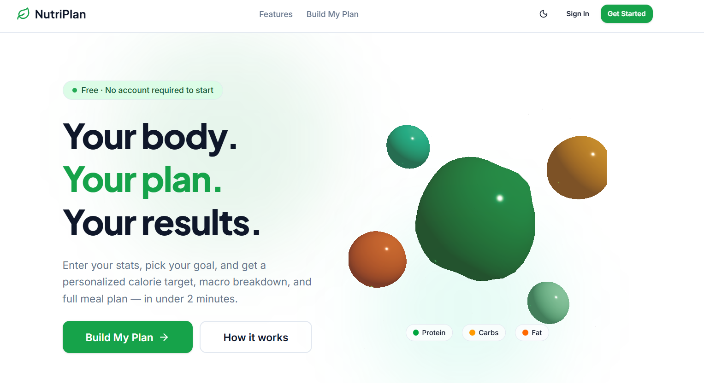

# NutriPlan

Personalised nutrition planning: enter your body stats and goal, get a science-backed calorie and macro target, and an AI-generated (Indian-first) meal plan whose nutrition is cross-checked against the USDA database. Save plans to a dashboard and reopen them any time.

**Live:** https://nutri-plan-ruddy.vercel.app · **Repo:** https://github.com/sanskar8176/NutriPlan



---

## What it does

| Step | What happens | Where |
|------|--------------|-------|
| 1. Profile | 4-step form: body stats (metric/imperial), activity level, goal + weekly rate, diet type + allergies. Live BMI preview. | `app/plan` |
| 2. Math | Mifflin-St Jeor BMR → TDEE (activity multiplier) → goal adjustment (±kcal from kg/week, 1200 kcal floor) → macros (protein per kg, 25 % fat, carbs remainder). | `lib/calculations.ts` |
| 3. AI meal plan | Profile is sent to **Gemini** (or a local Ollama model). The model returns 5 meals as structured JSON; each is validated, diet- and allergy-checked, cross-checked against **USDA FoodData Central**, and given an **Unsplash** photo. | `lib/ai-meal-plan.ts`, `lib/meal-plan-service.ts` |
| 4. Persist foods | Every AI meal is upserted into the `Food` table so it can be reused and referenced by saved plans. | `lib/meal-plan-service.ts` |
| 5. Results | Macro cards, BMI gauge, donut chart, "how we got here", and the meal plan with an "✦ AI" badge. Regenerate gives a different set. | `app/results` |
| 6. Save | Signed-in users save the plan. Macros/BMI are **recomputed on the server**; meals are stored in the `PlanMeal` join table. | `POST /api/plans`, `lib/plans.ts` |
| 7. Dashboard | Lists saved plans; "View Plan" reloads meals from the DB (no AI call); delete with confirmation. | `app/dashboard` |

**Graceful degradation.** Meal generation always returns something: local model → Gemini (with retry + fallback model) → foods already in the database → bundled static catalogue. The results page tells the user which source was used.

---

## Tech stack

| Layer | Technology |
|-------|------------|
| Framework | **Next.js 16** (App Router, Turbopack, React 19, TypeScript 5) |
| UI | Tailwind CSS 4, Radix primitives, lucide-react icons, framer-motion, recharts (donut chart), react-three-fiber / drei (hero animation), next-themes (dark mode), `next/font` (self-hosted Google fonts) |
| Forms & validation | react-hook-form + **zod 4** (one schema set shared by client forms and API routes) |
| Auth | **Auth.js v5 (next-auth beta)** — Credentials (bcrypt, cost 12) + Google OAuth, JWT sessions, Prisma adapter |
| Backend | Next.js Route Handlers (`app/api/**/route.ts`) running on Vercel serverless functions |
| Database | **PostgreSQL** (Supabase) via **Prisma 7** with the `pg` driver adapter; migrations in `prisma/migrations` |
| AI / data | Google Gemini via `@google/genai`; optional OpenAI-compatible local model (Ollama); USDA FoodData Central; Unsplash |
| Tooling | ESLint 9 (flat config), Vitest 4, GitHub Actions CI, Vercel Web Analytics |

---

## Quick start

### Prerequisites
- Node.js 20+ (22 recommended), npm 10+
- A PostgreSQL database. Easiest options:
  - **Docker:** `docker run -d --name nutriplan-pg -e POSTGRES_PASSWORD=nutriplan -e POSTGRES_USER=nutriplan -e POSTGRES_DB=nutriplan -p 54329:5432 postgres:16-alpine`
  - **Supabase:** create a project and copy the *Transaction pooler* (port 6543) and *Session pooler/direct* (port 5432) connection strings.

### 1. Install
```bash
npm install
```
`postinstall` runs `prisma generate` automatically.

### 2. Configure environment
```bash
cp .env.example .env.local
```
Fill in `.env.local`. Minimum to run: `AUTH_SECRET`, `DATABASE_URL`, `DIRECT_URL`. Everything else is optional and degrades gracefully (see the table in `.env.example`).

```bash
npx auth secret        # generates AUTH_SECRET
```

### 3. Create the schema
```bash
npm run db:deploy      # applies prisma/migrations (production-style)
# or, for quick local prototyping:
npm run db:push
```

### 4. (Optional) seed foods from USDA
```bash
npm run db:seed -- --limit 300
```
Without a seed the app still works: AI-generated foods are stored as they are produced, and the bundled catalogue covers the offline case.

### 5. Run
```bash
npm run dev            # http://localhost:3000
```

Production build locally:
```bash
npm run build && npm start
```

---

## Scripts

| Script | Purpose |
|--------|---------|
| `npm run dev` / `build` / `start` | Next.js dev server / production build / production server |
| `npm run lint` · `typecheck` · `test` | ESLint · `tsc --noEmit` · Vitest |
| `npm run check` | lint + typecheck + test (what CI runs) |
| `npm run db:generate` | Regenerate the Prisma client |
| `npm run db:migrate` | Create/apply a migration in development (`prisma migrate dev`) |
| `npm run db:deploy` | Apply pending migrations via `scripts/db-deploy.ts` (baselines db-push databases) — used by Vercel |
| `npm run db:push` | Push schema without migrations (prototyping only) |
| `npm run db:studio` | Prisma Studio GUI |
| `npm run db:seed` | Seed `Food` from USDA FoodData Central |
| `npm run vercel-build` | `tsx scripts/db-deploy.ts && next build` (Vercel runs this automatically) |

---

## Folder structure

```
nutriplan/
├─ app/                        # Next.js App Router (pages + API)
│  ├─ layout.tsx               # Root layout: fonts, theme, session provider, navbar, analytics
│  ├─ page.tsx                 # Landing page (ISR, 1 h)
│  ├─ plan/page.tsx            # 4-step profile form (client)
│  ├─ results/                 # Results dashboard (client) — macros, BMI, chart, meals, save
│  ├─ dashboard/               # Saved plans (server page + client list)
│  ├─ auth/signin, auth/error  # Sign-in / sign-up form, auth error page
│  └─ api/
│     ├─ auth/[...nextauth]/   # Auth.js handlers
│     ├─ auth/register/        # POST — create credentials account
│     ├─ meal-plan/            # GET  — generate plan (public) or load saved plan (owner only)
│     ├─ plan/                 # POST — stateless calculator (no AI/DB)
│     ├─ plans/                # GET list · POST save   (auth)
│     └─ plans/[id]/           # DELETE                 (auth, owner only)
├─ components/
│  ├─ ui/                      # Button, Card, Input, Navbar, providers
│  ├─ charts/macro-donut.tsx   # Recharts donut
│  └─ three/                   # Hero 3D animation (client-only, lazy)
├─ lib/                        # Server + shared logic (the "data access layer")
│  ├─ api-schemas.ts           # zod schemas for every API boundary (shared with the client)
│  ├─ validations.ts           # Multi-step form schemas
│  ├─ calculations.ts          # BMR / TDEE / macros / BMI (pure functions)
│  ├─ ai-meal-plan.ts          # Gemini / local model calls, USDA cross-check, Unsplash images
│  ├─ meal-plan-service.ts     # Provider chain + food persistence
│  ├─ meal-plan-db.ts          # Plan from foods already in the DB
│  ├─ food-data.ts             # Bundled static catalogue (last-resort fallback)
│  ├─ plans.ts                 # Saved-plan DAL (ownership-scoped queries)
│  ├─ allergens.ts             # Allergy keyword matching
│  ├─ rate-limit.ts            # In-memory rate limiter
│  ├─ images.ts                # Image host allow-list + category fallbacks
│  ├─ http.ts                  # JSON error helpers, safe body parsing
│  ├─ prisma.ts, db-config.ts  # Prisma client (lazy) + TLS-aware pool config
│  └─ usda-sync.ts             # USDA fetch/normalise helpers used by the seed script
├─ prisma/
│  ├─ schema.prisma            # User, Account, Session, VerificationToken, Plan, PlanMeal, Food
│  └─ migrations/              # SQL migrations (applied by `prisma migrate deploy`)
├─ scripts/seed-foods.ts       # USDA seed CLI
├─ tests/                      # Vitest unit + route-handler tests
├─ docs/                       # Architecture, API, security audit, deployment, user flows
├─ types/                      # next-auth session augmentation
├─ auth.ts                     # Auth.js configuration
├─ next.config.ts              # Security headers (CSP…), image allow-list
├─ prisma.config.ts            # Prisma CLI config (loads .env.local, uses DIRECT_URL)
├─ vercel.json                 # Vercel project config
└─ .github/workflows/ci.yml    # Lint · typecheck · test · audit · build on every push/PR
```

This is the standard Next.js App Router layout. Server-only data access lives in `lib/` (marked with `server-only` where it touches the DB), route handlers stay thin, and the client never receives more than the DTOs it needs.

---

## API overview

All responses are JSON. Authenticated routes use the Auth.js session cookie. Full details, request/response shapes and error codes: **[docs/api.md](docs/api.md)**.

| Method | Path | Auth | Purpose |
|--------|------|------|---------|
| GET | `/api/meal-plan?age=…&gender=…&…` | – | Generate a meal plan for a validated profile (rate-limited) |
| GET | `/api/meal-plan?planId=…` | ✔ owner | Meals of one of *your* saved plans |
| POST | `/api/plan` | – | Stateless calculator: macros + static meals from raw form data |
| GET | `/api/plans` | ✔ | List your saved plans |
| POST | `/api/plans` | ✔ | Save a plan (server recomputes macros/BMI) |
| DELETE | `/api/plans/:id` | ✔ owner | Delete one of your plans |
| POST | `/api/auth/register` | – | Create a credentials account (rate-limited) |
| * | `/api/auth/*` | – | Auth.js (sign-in, callback, session, csrf, providers) |

---

## Deployment (Vercel)

The project is deployed on **Vercel** through the GitHub integration — there is no custom pipeline to maintain.

```
git push → GitHub → Vercel builds → Preview (PRs / branches) or Production (main)
```

1. **Trigger:** every push to `main` creates a Production deployment; every pull request / other branch gets a unique Preview URL (confirmed via the repo's GitHub *Deployments* tab).
2. **Install:** `npm ci` → `postinstall` runs `prisma generate`.
3. **Build:** Vercel runs `npm run vercel-build` = **`tsx scripts/db-deploy.ts && next build`**. Pending migrations are applied first (self-baselining an existing schema), so the database schema and the code always ship together. If the database is unreachable the build fails loudly instead of deploying a broken app.
4. **Runtime:** pages and route handlers run as serverless functions in Vercel's Node.js runtime; the landing page is ISR (revalidated hourly); static assets go to the CDN.
5. **Environment variables** are set in *Vercel → Project → Settings → Environment Variables* (same keys as `.env.example`; `AUTH_URL` is not needed on Vercel).
6. **Google OAuth:** add `https://<your-domain>/api/auth/callback/google` to the OAuth client's authorised redirect URIs.

**CI:** `.github/workflows/ci.yml` runs lint, typecheck, unit tests, `npm audit --audit-level=high` and a production build on every push and PR, so broken code is caught before Vercel builds it. Vercel's own "Ignored Build Step" can additionally be set to wait for CI if desired.

**Databases per environment:** local development uses a Docker Postgres (URLs in `.env.local`); Vercel Preview/Production use Supabase (URLs in Vercel's environment variables). Supabase connections are TLS-verified with the bundled Supabase root CA. **AI per environment:** on Vercel only Gemini is configured, so the chain is Gemini → database → static; locally you may additionally point `LOCAL_MODEL_NAME` at an Ollama model, which is then tried first.

**Migrations on deploy:** `vercel-build` runs `scripts/db-deploy.ts` before `next build`. It applies pending migrations and, for a database that was originally created with `prisma db push` (like the current production one), first records the initial migration as already applied so the deploy does not fail. Details in [docs/deployment.md §3.1](docs/deployment.md).

---

## Security

A full audit was performed and every finding fixed; see **[docs/security-audit.md](docs/security-audit.md)**. Highlights of what is now in place:

- Ownership-scoped data access (no IDOR on saved plans), auth required on all plan routes
- Strict input validation (zod) on every route, query string and URL parameter; server-side recomputation of all derived values
- Rate limiting on registration, sign-in, plan generation and plan saves
- Password policy (8–72 chars), bcrypt cost 12, e-mail normalisation, timing-safe login
- Open-redirect protection on `callbackUrl`
- Content-Security-Policy + HSTS + frame/MIME/referrer/permissions headers, `X-Powered-By` removed
- TLS certificate verification for the database connection
- Dependency upgrades clearing all critical/high advisories (Next.js RCEs, zod, undici, …)
- Secrets scrubbed from the repo; `.env.example` is the only tracked env file; logs are git-ignored

---

## Testing

```bash
npm run check   # lint + typecheck + 81 Vitest tests
```

- `tests/calculations.test.ts` — nutrition math
- `tests/api-schemas.test.ts`, `tests/allergens.test.ts`, `tests/food-data.test.ts`, `tests/meal-plan-utils.test.ts`, `tests/images-and-utils.test.ts`, `tests/rate-limit.test.ts`, `tests/prisma-config.test.ts` — library behaviour
- `tests/routes.test.ts` — route handlers with auth/DB mocked: 401s, ownership, validation, malformed JSON, rate limiting, error masking

Manual end-to-end verification (local production build against Docker Postgres) is documented in [docs/testing.md](docs/testing.md).

---

## Documentation

| Doc | Contents |
|-----|----------|
| [docs/architecture.md](docs/architecture.md) | System architecture, request/sequence diagrams for every API call, AI pipeline, data model (ERD) |
| [docs/user-flow.md](docs/user-flow.md) | User journeys (guest, sign-up, save, revisit) |
| [docs/api.md](docs/api.md) | Endpoint reference with schemas and error codes |
| [docs/security-audit.md](docs/security-audit.md) | Findings, severity, fixes, residual risk and recommendations |
| [docs/deployment.md](docs/deployment.md) | Vercel pipeline, environment, database setup/migration, recovery runbook |
| [docs/testing.md](docs/testing.md) | Test strategy, how to run, manual E2E checklist and results |
| [docs/roadmap.md](docs/roadmap.md) | Suggested enhancements |

---

## License

© Sanskar Singh. All rights reserved. Food photos by [Unsplash](https://unsplash.com); nutrition data by [USDA FoodData Central](https://fdc.nal.usda.gov/).
