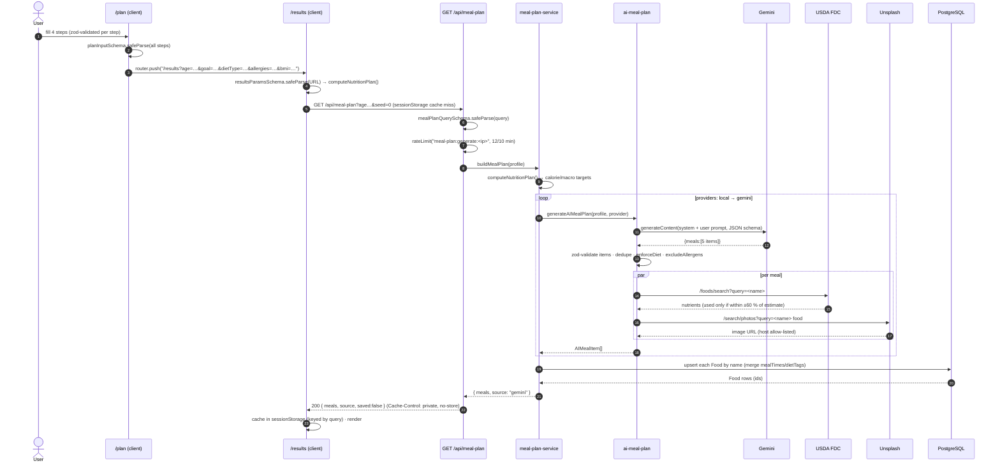
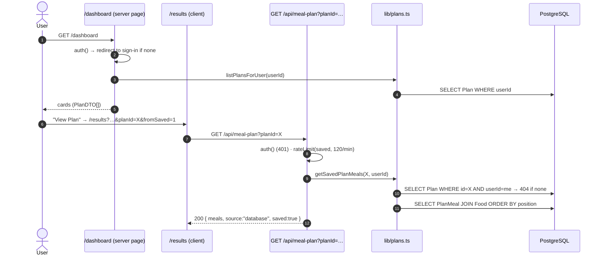
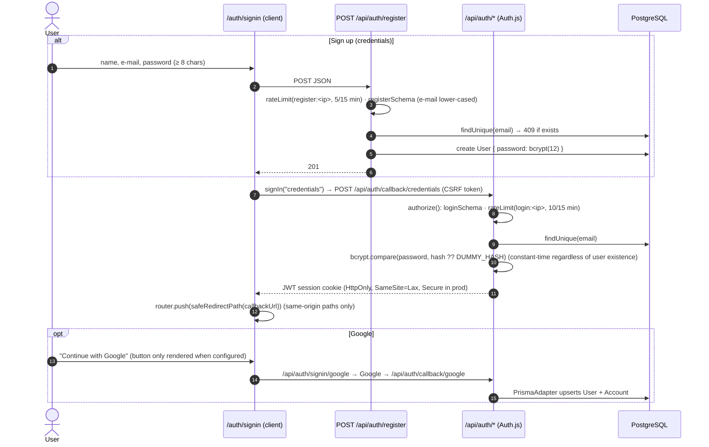
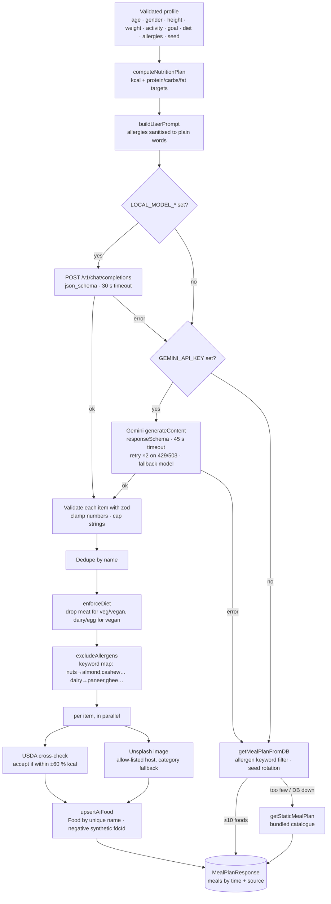
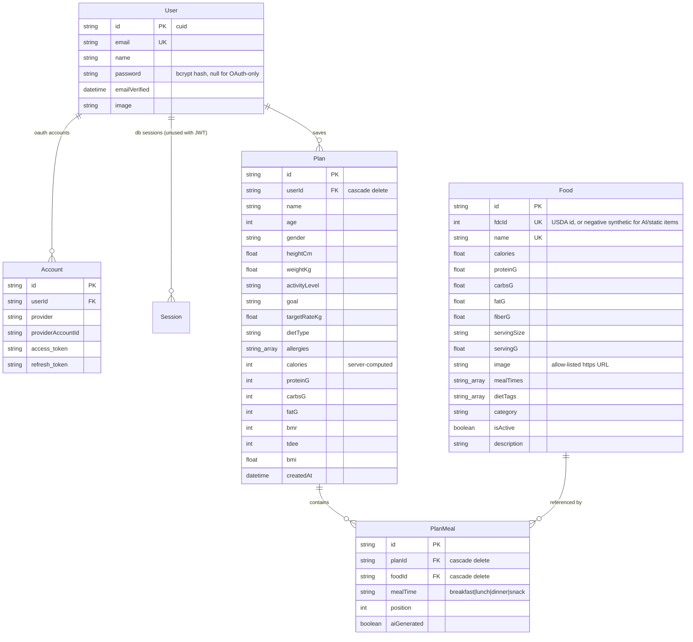

# NutriPlan — Architecture

Diagrams are written in [Mermaid](https://mermaid.js.org/); GitHub, VS Code (with the Mermaid extension) and most Markdown viewers render them inline.

## 1. System context

```mermaid
flowchart LR
    U[👤 User<br/>browser] -->|HTTPS| V[Vercel Edge/CDN]
    V --> N[Next.js 16 app<br/>Server Components + Route Handlers<br/>Vercel serverless functions]
    N -->|Prisma + pg over TLS| DB[(PostgreSQL<br/>Supabase)]
    N -->|@google/genai| G[Google Gemini]
    N -->|OpenAI-compatible HTTP<br/>optional| L[Local model<br/>Ollama / LM Studio]
    N -->|REST| USDA[USDA FoodData Central]
    N -->|REST| UNS[Unsplash API]
    N -->|OAuth 2 / OIDC| GO[Google Accounts]
    U -->|img src| IMG[images.unsplash.com]
    U -->|beacon| VA[Vercel Web Analytics]
```

## 2. Application layers

```mermaid
flowchart TB
    subgraph Client["Browser (React 19 client components)"]
        P[/plan form<br/>react-hook-form + zod/]
        R[/results dashboard/]
        D[/dashboard/]
        S[/sign-in form/]
    end

    subgraph Server["Next.js server (App Router)"]
        SC[Server pages<br/>app/page.tsx · app/dashboard/page.tsx]
        RH[Route handlers<br/>app/api/**]
        AUTH[auth.ts<br/>Auth.js v5]
    end

    subgraph Lib["lib/ — domain + data-access layer"]
        SCH[api-schemas.ts<br/>zod validation]
        CALC[calculations.ts<br/>BMR · TDEE · macros · BMI]
        SVC[meal-plan-service.ts<br/>provider chain + persistence]
        AI[ai-meal-plan.ts<br/>Gemini / local · USDA · Unsplash]
        MDB[meal-plan-db.ts<br/>plan from stored foods]
        STATIC[food-data.ts<br/>bundled catalogue]
        PLANS[plans.ts<br/>ownership-scoped plan DAL]
        RL[rate-limit.ts]
        ALG[allergens.ts]
        PR[prisma.ts]
    end

    P -->|router.push /results?…| R
    R -->|GET /api/meal-plan| RH
    R -->|POST /api/plans| RH
    D -->|DELETE /api/plans/:id| RH
    S -->|POST /api/auth/register · signIn()| RH
    RH --> AUTH
    RH --> SCH
    RH --> RL
    RH --> SVC
    RH --> PLANS
    SC --> PLANS
    SC --> PR
    SVC --> CALC
    SVC --> AI
    SVC --> MDB
    SVC --> STATIC
    AI --> ALG
    MDB --> ALG
    STATIC --> ALG
    PLANS --> CALC
    PLANS --> PR
    MDB --> PR
    SVC --> PR
    AUTH --> PR
```

**Principles**

- **Thin route handlers, fat `lib/`.** Handlers do auth → rate limit → validate → call a `lib/` function → shape the response. Business rules and DB access live in `lib/`, which is also where the unit tests point.
- **One schema set.** `lib/api-schemas.ts` is imported by both the client (results page validates its URL parameters) and the server (route handlers validate query/body). Enums for gender, activity, goal, diet and meal time are defined once.
- **Ownership is enforced in the DAL.** Every function in `lib/plans.ts` takes `userId` and scopes the query (`where: { id, userId }`), so a handler cannot forget the check.
- **Derived values are never trusted from the client.** Calories, macros, BMR, TDEE and BMI are recomputed on the server when a plan is saved.
- **Degrade, don't fail.** Meal generation is a chain of independent stages (see §4); every external dependency has a timeout.

## 3. Request flows (sequence diagrams)

### 3.1 Generate a plan (guest or signed-in)



Fallbacks (not shown): if every AI provider throws, `SVC` tries `getMealPlanFromDB()` (foods already stored, allergen-filtered, seed-rotated); if the table is too small or the DB is down, `getStaticMealPlan()` from the bundled catalogue. The response's `source` tells the UI which one was used.

### 3.2 Save a plan

```mermaid
sequenceDiagram
    autonumber
    actor U as User
    participant R as /results (client)
    participant API as POST /api/plans
    participant A as auth()
    participant DAL as lib/plans.ts
    participant DB as PostgreSQL

    U->>R: click "Save Plan"
    alt not signed in
        R->>R: router.push("/auth/signin?callbackUrl=<same-origin path>")
    else signed in
        R->>API: POST { profile, allergies, meals:[{foodId, mealTime, position, aiGenerated}] }
        API->>A: session?.user.id (401 if none)
        API->>API: rateLimit("plan-save:<userId>", 30/15 min)
        API->>API: readJsonBody (400 on malformed) · savePlanBodySchema (400 with issues)
        API->>DAL: createPlanForUser(userId, input)
        DAL->>DAL: computeNutritionPlan() + calculateBMI()  (client values ignored)
        DAL->>DB: resolve foodIds (materialise static catalogue items on first use; 400 for unknown ids)
        DAL->>DB: INSERT Plan + PlanMeal[]
        DB-->>DAL: Plan
        DAL-->>API: PlanDTO (no userId / internals)
        API-->>R: 201 PlanDTO
    end
```

### 3.3 Open a saved plan from the dashboard



### 3.4 Authentication



## 4. AI meal-plan pipeline



Why the model is only one input: the model proposes dishes; the app owns the hard constraints (diet, allergens, numeric sanity, image origin) and re-checks them in code. A hallucinated "Paneer Tikka" in a vegan plan, or a `calories: -5`, never reaches the UI or the database.

## 5. Data model



Indexes: `Food(dietTags)`, `Food(mealTimes)`, `Food(isActive)` (GIN-style array lookups for plan building), `PlanMeal(planId)`.

## 6. Rendering & caching

| Route | Mode | Notes |
|-------|------|-------|
| `/` | Static + ISR (1 h) | Meal preview from DB; falls back to static items if the DB is unavailable |
| `/plan`, `/results`, `/auth/*` | Static shell, client-rendered | Results reads the URL on the client inside `<Suspense>` |
| `/dashboard` | Dynamic (server) | Reads the session cookie; redirects when signed out |
| `/api/*` | Dynamic | `Cache-Control: private, no-store` (set globally in `next.config.ts`) |

Generated plans are cached in `sessionStorage` per query string so navigating back/forward does not re-trigger AI calls.

## 7. Security architecture (summary)

See [security-audit.md](security-audit.md) for the full list. In short: Auth.js JWT sessions; per-route auth + ownership checks in the DAL; zod validation at every boundary; in-memory rate limits per IP/user; CSP/HSTS/frame/MIME headers; TLS-verified DB connection; secrets only in environment variables; dependencies pinned to patched versions.
