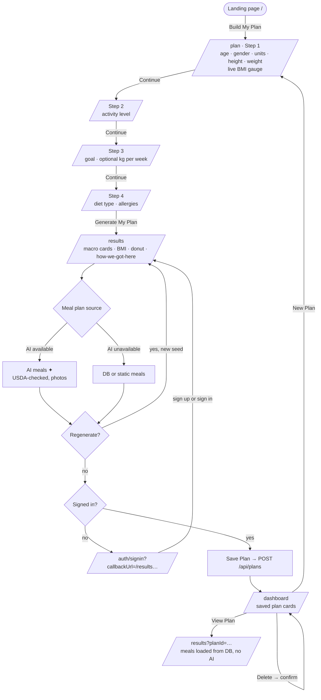
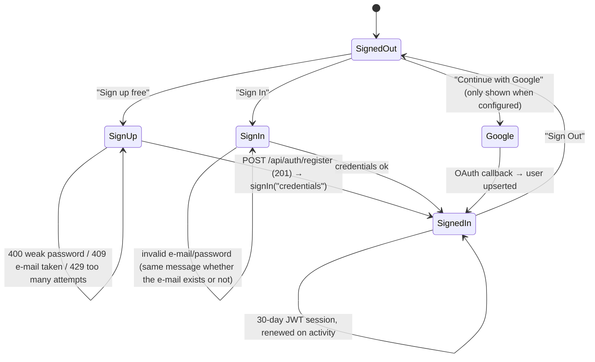

# NutriPlan — User Flows

## 1. End-to-end journey

## 2. Guest vs. signed-in

| Capability | Guest | Signed-in |
|------------|-------|-----------|
| Build a profile and get macros/BMI | ✔ | ✔ |
| Generate / regenerate AI meal plans | ✔ (rate-limited per IP) | ✔ |
| Save a plan | ✖ → prompted to sign up (returns to the same results page afterwards) | ✔ |
| Dashboard, reopen saved plans, delete | ✖ | ✔ (own plans only) |

## 3. Account flows

After sign-in the app returns to `callbackUrl` **only if it is a same-origin path**; anything else lands on `/dashboard`.

## 4. Results page states

| State | What the user sees |
|-------|--------------------|
| Invalid / missing URL parameters | "We need a few details first" with a button to the form (no crash, no NaN) |
| Loading (fresh) | Four-stage progress ("Asking the AI nutritionist… → USDA → photos → finalising") with skeleton cards |
| Loading (saved) | Pulsing skeleton cards |
| Loaded | Meals grouped by time, "✦ AI" badge on generated items, a line stating the source ("Generated by Gemini…", "Built from our verified food database", "…bundled starter catalogue") and the exclusions applied |
| Error | Specific message (sign in required · plan not found · slow down · network) with "Try again" / "Sign in" actions |
| Saved | "Plan saved! 🎉" with a dashboard link; for plans opened from the dashboard: "already in your dashboard" |

## 5. How AI helps, step by step

1. **Composition** — the profile (goal, activity, calorie and macro targets, diet, allergies, variety seed) is turned into a prompt; the model returns 5 Indian-first meals with portion sizes and estimated nutrition as structured JSON.
2. **Guard-rails** — every item is validated and clamped; items that break the diet (meat in a vegetarian plan, dairy in a vegan plan) or mention an allergen are dropped in code.
3. **Verification** — each meal name is looked up in USDA FoodData Central; when a close match exists its calories/macros replace the model's estimate.
4. **Presentation** — an Unsplash photo is attached (allow-listed host, category fallback).
5. **Memory** — the meals are stored in the `Food` table, so saved plans reopen instantly and the database fallback gets richer over time.
6. **Transparency** — the UI labels AI items and states which source produced the plan.
